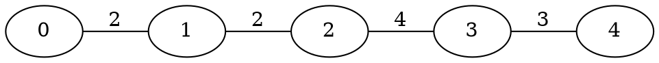

# DTDP - Dynamic Train Dispatching Problem

A minimal NP-hard problem for evolving train scheduling algorithms with ShinkaEvolve.

**Target:** Japan railway system PoC

---

## Problem Overview

```
Given:  Railway network G = (V, E) + set of trains
Find:   Departure time for each train
Goal:   Minimize delays + conflicts
```

### Why This Problem?

| Property | Value | Why It Matters |
|----------|-------|----------------|
| NP-hard | ✓ | No polynomial solution exists |
| Minimal | 5 files | Easy to understand |
| Visual | ✓ | Time-space diagrams, ASCII graphs |
| Scalable | 4→100+ trains | Difficulty can grow |
| Real-world | Japan railways | Practical application |

---

## Graph Model: G = (V, E)

```
V = {stations}              ← Nodes
E = {(u,v) → travel_time}   ← Weighted edges (single-track)
```

### Example: Linear Corridor

```
[0]--2--[1]--2--[2]--4--[3]--3--[4]
     ↔       ↔       ↔       ↔
  segment segment segment segment
```

### Example: Branching Network

```
          [5]
           |
[0]--[1]--[2]--[3]--[4]
           |
          [6]--[7]
```

---

## Solution Format

A solution is just: **when does each train depart?**

```python
schedule = {
    0: 5,    # Train 0 departs at t=5
    1: 8,    # Train 1 departs at t=8
    2: 12,   # Train 2 departs at t=12
}
```

---

## Fitness Function

```
fitness = delay + conflicts + makespan
          (lower = better)
```

| Component | Weight | Description |
|-----------|--------|-------------|
| Delay | 1.0 | `(departure - earliest) × priority` |
| Conflicts | 50.0 | Trains on same segment at same time |
| Makespan | 0.1 | Total schedule duration |

---

## File Structure

```
dtdp/
├── problem.py    # Graph model, instance generation
├── fitness.py    # Solution evaluation
├── solver.py     # Solver interface + baselines
├── visualize.py  # ASCII visualizations
├── shinka.py     # ShinkaEvolve integration
└── README.md
```

---

## ShinkaEvolve Integration

### Quick Start

```python
from shinka import DTDPProblem

# Create problem
problem = DTDPProblem(difficulty="medium")

# Get template
print(problem.get_template())

# Evaluate a solver
score = problem.evaluate(my_solver)

# Get feedback for LLM
feedback = problem.get_feedback()
```

### Solver Template

```python
def solve(inst: Instance) -> Schedule:
    """
    Args:
        inst.graph: RailGraph with vertices, edges
        inst.trains: List[Train] with id, origin, destination, earliest, priority
        inst.horizon: Maximum time
    
    Returns:
        Dict[train_id, departure_time]
    """
    schedule = {}
    
    # YOUR ALGORITHM HERE
    for train in inst.trains:
        schedule[train.id] = train.earliest
    
    return schedule
```

### Available Helpers

```python
# Path finding
path = inst.graph.path(origin, dest)  # Returns [0, 1, 2, 3] or None

# Travel time
time = inst.graph.travel_time(u, v)   # Returns int

# Neighbors
neighbors = inst.graph.neighbors(v)   # Returns [connected stations]

# Train properties
train.id          # Unique ID
train.origin      # Start station
train.destination # End station
train.earliest    # Earliest departure time
train.priority    # Delay penalty weight (1.0 = normal)
```

---

## Baseline Results

```
Solver              Score   Conflicts  Delay
--------------------------------------------------
naive              15524.9    311      0.0
greedy_fcfs        15524.9    311      0.0
greedy_priority    15524.9    311      0.0
direction_wave     11266.7    186    1266.7   ← Best baseline
```

**Goal:** Beat `direction_wave` (score < 11266.7)

---

## Visualization

### Time-Space Diagram

```
     0         10        20        
S0   X····44XXX1··········
S1   XXX44XXX1············
S2   ··XXXX1··············
S3   ··1·XXXXX············
S4   ········2222·········

Legend:
  · = empty
  0-9 = train ID
  X = conflict!
```

### Graph (DOT format)

```python
from problem import generate
inst = generate(num_stations=5, seed=42)
print(inst.graph.to_dot())
```

Output:


Render: `dot -Tpng graph.dot -o graph.png`

---

## Difficulty Levels

| Level | Stations | Trains | Conflicts | Use Case |
|-------|----------|--------|-----------|----------|
| Easy | 4-5 | 4-5 | Few | Initial testing |
| Medium | 5-7 | 8-10 | Moderate | Algorithm tuning |
| Hard | 8-10 | 15-20 | Many | Final evaluation |

```python
problem = DTDPProblem(difficulty="easy")    # 2 instances
problem = DTDPProblem(difficulty="medium")  # 3 instances
problem = DTDPProblem(difficulty="hard")    # 3 instances
problem = DTDPProblem(difficulty="full")    # All 8 instances
```

---

## Algorithm Ideas to Evolve

### Simple Mutations
- Shift departure time ±δ
- Swap two trains' departure times
- Reset one train to earliest

### Heuristics to Explore
- Sort by priority, schedule greedily
- Separate by direction (reduce head-on)
- Time-slot reservation
- Conflict resolution with backtracking

### Advanced Approaches
- Genetic algorithm with crossover
- Simulated annealing
- Constraint propagation

---

## Example: Evaluating an Evolved Solver

```python
from shinka import DTDPProblem
from problem import Instance
from fitness import Schedule

def evolved_solver(inst: Instance) -> Schedule:
    """Algorithm generated by ShinkaEvolve."""
    schedule = {}
    
    # Sort trains by priority (high first) then earliest time
    sorted_trains = sorted(
        inst.trains,
        key=lambda t: (-t.priority, t.earliest)
    )
    
    # Assign departure times with spacing
    time_cursor = 0
    for train in sorted_trains:
        schedule[train.id] = max(train.earliest, time_cursor)
        time_cursor = schedule[train.id] + 3  # Gap between trains
    
    return schedule

# Test it
problem = DTDPProblem(difficulty="full")
score = problem.evaluate(evolved_solver)
print(f"Score: {score}")
print(problem.get_feedback())
```

---

## Japan Railway Context

This PoC models key challenges of Japan's railway system:

1. **Single-track sections** in rural areas
2. **High-frequency scheduling** (Shinkansen every 10 min)
3. **Priority trains** (Nozomi > Hikari > Kodama)
4. **Tight connections** at junction stations

The problem can scale to model:
- Tokaido Shinkansen corridor
- Regional branch lines
- Complex junction stations like Shin-Osaka

---

## Next Steps

1. **Integrate with ShinkaEvolve** - Use `DTDPProblem` class
2. **Evolve algorithms** - LLM generates solver variations
3. **Visualize results** - Time-space diagrams for analysis
4. **Scale up** - Increase stations/trains for harder problems
5. **Real data** - Import actual Japan railway schedules
